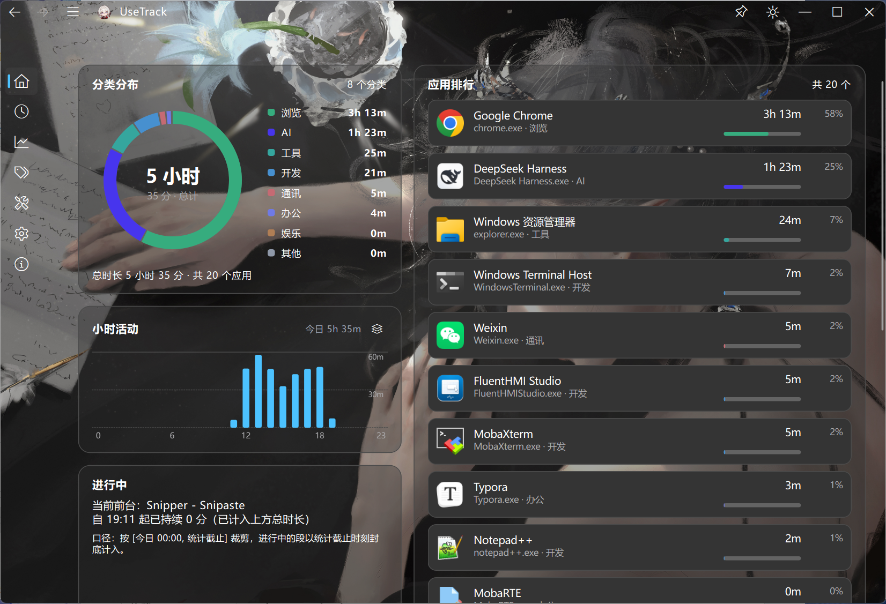
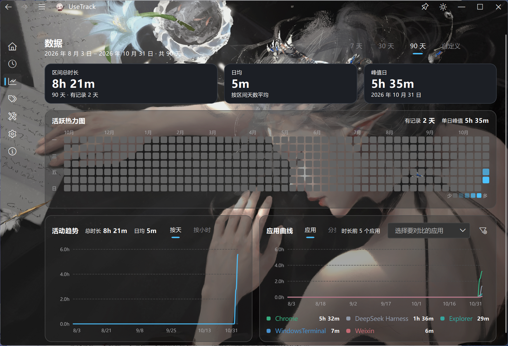

# UseTrack

Windows 本地应用使用时长追踪工具。常驻托盘，自动记录前台应用切换，把一天的时间流向摊开给你看。

完全离线，不联网、不上传、不收集任何数据——所有记录都躺在你本机的 SQLite 里。



## 功能

**今日概览** — 当前在用什么、今天用了多久、各应用和分类的时长分布、小时活动图、与昨日对比。

**历史回看** — 按天翻页，24 小时时间轴一条色带铺满全天（每个时刻只显示占时最多的那个应用），下方是活动流明细，右侧是当日分布图例。双击时间轴可以放大到 1–24 小时的视口看分应用明细轨。



**数据统计** — 7 天 / 30 天 / 90 天 / 自定义区间的趋势曲线，支持按应用或按分类看，可自选要对比的应用；还有全年热力图。

**分类管理** — 给应用改显示名、配色、归到自定义分类；把几个 exe 关联成「同一个应用」，统计时合并到父应用头上；把不想看到的应用藏起来。

**小工具** — 提醒、倒计时、番茄钟。

**设置** — 数据目录迁移、CSV / Markdown / SQLite 三种格式导出、外部数据导入（带预览和批次回滚）、历史清理、备份恢复。

## 技术栈

| | |
|---|---|
| 语言 | C++17 |
| UI | Qt 6.8 Widgets + [ElaWidgetTools](https://github.com/Liniyous/ElaWidgetTools) |
| 构建 | CMake + MSVC (x64) |
| 存储 | SQLite（经 `QSqlDatabase`） |

除 ElaWidgetTools 外无第三方依赖。所有图表用 `QPainter` 自绘。

## 架构

```
src/
├── main.cpp
├── app/        应用壳：主窗口、托盘、单实例、追踪服务编排
├── engine/     追踪引擎：采样时序、session 生命周期、AFK/锁屏/休眠边界
├── platform/   Win32 收口：窗口枚举、电源通知、图标提取、注册表自启
├── data/       SQLite：schema/migration、repository、读模型聚合
├── ui/         页面 widgets，按功能分目录
└── shared/     跨模块纯工具
```

几条硬边界：

- 所有 Win32 调用只出现在 `platform/`，其余层不碰 `<windows.h>` 业务 API
- `ui/` 不写 SQL、不 include `platform/`，数据一律经 `data/` 的接口
- `engine/` 拥有采样时序与 session 边界语义，是整套东西的核心


## 数据位置

默认在 `%APPDATA%\UseTrack\`：

```
config.json     数据目录等设置
usetrack.db     活动记录
wallpaper/      壁纸缓存
```

数据目录可在设置页改到别处，会实际搬迁库文件并校验行数。
